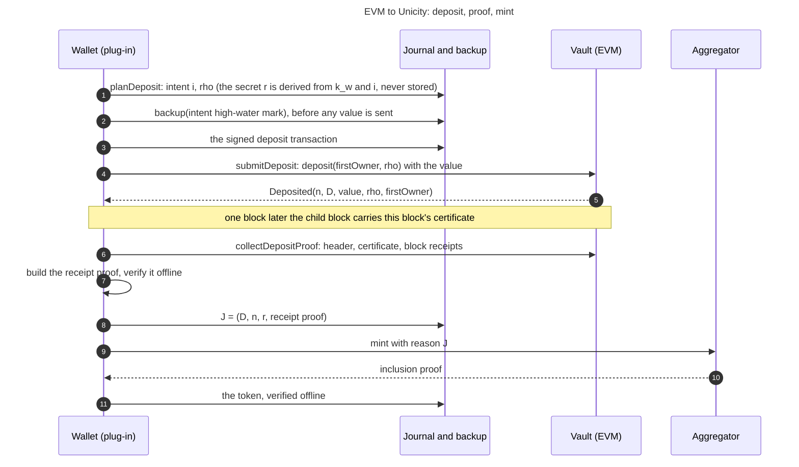
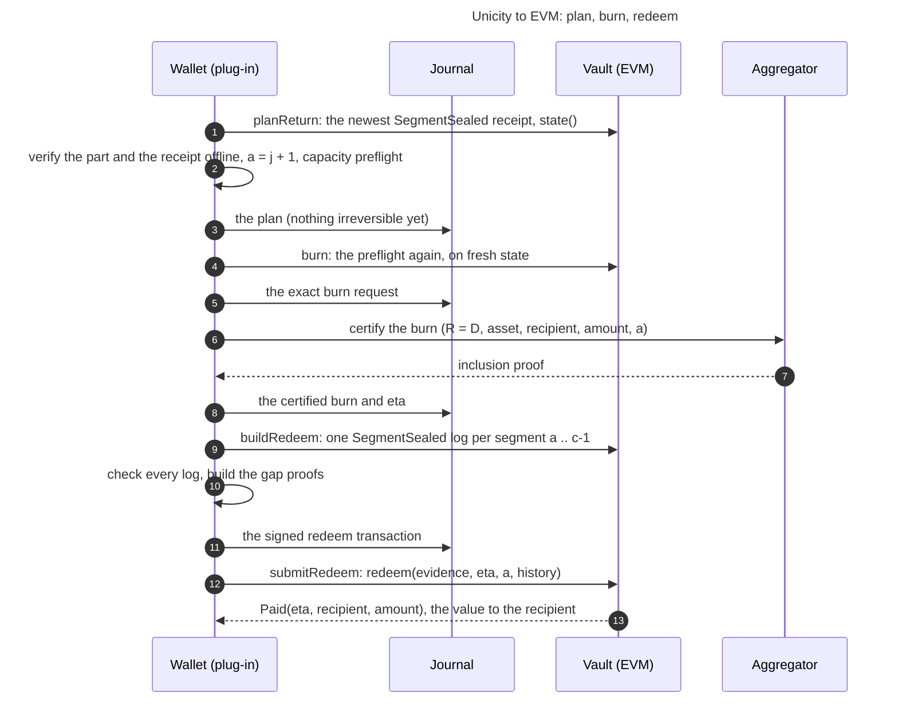

# Native bridge v2 wallet integration guide

The wallet opens under an authenticated B1 evaluation origin from the release's `trust.origin` or the
`init --trust-origin FILE` override. Both forms contain decimal strings `usableEpoch` and `rootRound` from the
trusted deployment or registry checkpoint channel. Unlocking and proving lineage use this origin for every
certificate. For a moving deployment, update the origin file with a newer authenticated checkpoint and reopen
the wallet. UTB refresh updates the held history. A new origin requires its own authenticated checkpoint.


This guide is for a wallet developer. It shows how to move native UCT between the EVM chain and Unicity with the TypeScript plug-in
(`packages/native-bridge-plugin`, entry point `./nb2`). You don't handle segments, gap proofs or receipt tries yourself: the plug-in builds and
checks them. The guide walks through the reference command-line wallet in [`wallet/`](../wallet), which runs every step, and you can follow it
on a test deployment.

The rules behind each step are in bft-core
[`docs/design/native-bridge-v2.md`](https://github.com/ristik/bft-core/blob/integration/enshrined-evm/docs/design/native-bridge-v2.md) (the
spec; section numbers below refer to it), [`protocol/interop.md`](../protocol/interop.md) (the bytes) and [`nb2-journal.md`](nb2-journal.md)
(the journal format).

> **Test value only.** A release must qualify recovery capacity, peak archive growth and end-to-end payout before funding a production generation.

- [What a user can do](#what-a-user-can-do)
- [Try it: the reference wallet](#try-it-the-reference-wallet)
- [Continuation v1.1 and relayers](#continuation-v11-and-relayers)
- [The two flows](#the-two-flows)
- [Using the plug-in](#using-the-plug-in)
- [What to persist, and when](#what-to-persist-and-when)
- [What can go wrong](#what-can-go-wrong)
- [What it costs](#what-it-costs)
- [Limits](#limits)
- [RPC requirements](#rpc-requirements)

## What a user can do

- **Deposit.** Lock UCT in the vault contract on the EVM chain. The user gets the same amount as an ordinary Unicity token.
- **Spend it on Unicity.** Transfer and split the token like any other token. Nothing touches the EVM.
- **Return.** Burn a whole token part. The vault pays that part's amount to the EVM address the burn names.

A part is returned whole. To return 40 of a 100 token, split it into 40 and 60 first, then return the 40.

## Try it: the reference wallet

The reference wallet is a small command-line program on the plug-in, with one command per bridge step. Its core
([`wallet/core.ts`](../wallet/core.ts)) is also what the bft-core testnet lane drives, so the commands below are the ones the lane tests on
every run.

### What you need

- **The deployment's public files**, from its operator (a bft-core testnet package publishes them from `GENERATION/bridge/nb2/public/`):
  - `nb2-release.json`, the release manifest. It holds the pins the wallet checks the deployment against (Γ, the vault's runtime code hash, the
    limits, the deployment block), the operating envelope, and the plug-in commit it was released with (`bridge.sources`).
  - `trust-base.bundle.cbor` and `trust-base.genesis.entryid`: the network's trust-base history and its pin.
- **The deployment's public gateway URL.** It is the ordinary JSON-RPC endpoint; the aggregator is its `/aggregator` route.
- **A checkout of this repository** at the commit the manifest names, with Node 22:

  ```sh
  git clone https://github.com/ristik/native-bridge-plugins && cd native-bridge-plugins
  git checkout <bridge.sources["native-bridge-plugins"] of nb2-release.json>
  npm ci
  ```

- **Some UCT on the EVM chain** for the deposit itself and for gas (the faucet of a test deployment).

Every command is `npx tsx wallet/nb2-wallet.ts [--wallet DIR] COMMAND ...`, written `nb2-wallet` below. The wallet directory defaults to
`./nb2-wallet`. It holds an **unencrypted** secret: this is a test wallet.

### Receive and inspect return headroom

Give the sender the compressed Unicity owner key printed by `address`. Import the resulting
flat token with `receive NAME TOKEN_FILE`. Use `--owner INDEX` when the destination key is one
of the wallet's other local owner keys. The wallet verifies the full ancestry, selected split
allocation and owner before storing the token. Both `receive` and `transfer` print evidence
bytes, the ordinary history capacity by bytes, and the minimum recovery packet count by
operation count. `plan-return` measures the current fee and capacity limits.

## Continuation v1.1 and relayers

Use the operator-authenticated v1.1 release and origin. The release's `recovery` object contains
the hex `salt`, `address`, `runtimeHash` and `pins`; measured `ranges` for each funded entry point,
operation count, gap count and supported receipt interval; and a `backlog` object. Each range has
`minReceiptBytes`, the T5 `RecoveryShape` as `max`, and the measured upper bound `execution` as a
decimal string. The optional `ordinaryRanges` qualify the ordinary route under the same graph.
Each range specifies integer `maxEvidenceBytes` and `maxOperations`, plus `maxGaps` and
`execution` as decimal strings. Its execution bound covers all smaller eligible shapes before
the wallet adds intrinsic gas, forwarding margin and the seal reserve. The backlog has decimal strings `duringProgress`, `peakSeals`, `elapsedMs`,
`receiptP99Ms`, `advancePeakSeals`, `finalInclusionMs`, `finalPeakSeals` and `qualifiedForMs`.
The advance and final peaks are measured over their respective windows. The wallet reads the
current endpoint and independently authenticates the signed start. [Continuation specification, §§7–9](https://github.com/ristik/bft-core/blob/integration/enshrined-evm/docs/design/nb2-continuation-v1.1.md)

Supply a separate payer policy with `--return-policy FILE`. Use JSON integers for `signedBytes`
and `calldataBytes`, and decimal strings for `gas`, `maxNonce`, `maxFeePerGas`,
`maxPriorityFeePerGas`, optional `maxTransactionFee` and total `feeBudget`. Values are ceilings,
with fees in wei. Set `archives` to an array of independent archive RPC URLs. The wallet applies
the stricter local and release limits, checks the payer's live balance and nonce, and accounts
for pending and completed attempts. Ordinary and recovered attempts from the same payer
share a total fee budget in the local return journal. Use a dedicated payer account while
this flow is active.

```sh
nb2-wallet plan-return coin --recipient "$RECIPIENT" --return-policy payer.json
nb2-wallet burn coin --recipient "$RECIPIENT" --return-policy payer.json --backup coin.private.json
nb2-wallet redeem coin --return-policy payer.json
```

The ordinary route is used when its measured reserve, byte and funding bounds fit. Otherwise,
cold admission prices the bounded terminal operation, Progress, certified gap advances and
final settlement. The wallet repeats admission before authorizing the burn. Repeat `burn` after
an interruption to reconcile the same signed request. An authorized backup destination is
durable before signing, and its private copy is published before submitting the request. The
backup holds the complete provenance and signed request. Keep it private and hand it only to
the chosen relayer before starting payout. Use `backup-return coin FILE` to save a signed return
or a certified Complete or Paid handoff to a new path.

On another device, verify the release and configure a funded relayer EVM key in `RELAY_PAYER`.
Use a private local directory for the resumed journal. The payout address and amount come from
the holder's signed burn.

```sh
nb2-wallet --wallet ./relay-state resume coin.private.json --release /release/nb2-release.json \
  --rpc "$RPC" --payer-env RELAY_PAYER --return-policy relay-payer.json
```

Repeat the same command if inclusion or certification is pending. Supply an alternate archive
when a reader reports `EvidencePruned` and the backup lacks the needed proof. A certified backup
can restore the burn and its Complete or Paid evidence with the certifier offline. Keep the journal
when moving between routes. It records this payer's signed attempts and their fee reservations.
A fresh relayer needs a policy that accounts for any fees it already spent.

### Return journal reconciliation

Use one active payer per burn. Hand the initial signed backup to the selected payer before any
EVM send. The first payout send binds the payer's address for the life of that journal.
Resume with that key after Progress, after a certified failure and when switching resolved routes. Hand off at certified
Complete or Paid. This lets the next payer settle a completed lineage under its own limits.
Progress, Gap and packet schedules stay in the originating journal. A backup made while a send
is unresolved or a run is incomplete identifies an active payer handoff and refuses import into
a fresh journal. Ask the active payer to resume or produce a resolved Complete or Paid backup.

Redeem, redeem with recovery, resume, import and restore check for certified Paid before
qualifying or signing a payout. Import authenticates the source, return ID, recipient, amount
and start anchor. Import and restore read EVM receipts without broadcasting transactions.

| Local state | Signed request or certified burn | Peer Progress or Gap | Certified Complete | Certified Paid, either route |
| --- | --- | --- | --- | --- |
| Absent or planned | Adopt matching request and certify, or attach supplied terminal | Refuse active payer handoff | Store terminal proof independently of funding | Adopt with matching signed request |
| Signed burn, no local execution | Reconcile the exact request | Refuse an active payer handoff and identify the original payer | Store Complete independently of funding | Record Paid |
| Local recovery in progress | Reconcile the exact send | Keep local progress and reconcile its send | Reconcile local send first, then store Complete and clear the obsolete plan | Record Paid, retain local signed bytes |
| Local Complete or later local Gap | Keep local checkpoint | Keep local checkpoint | Keep local checkpoint | Record Paid and close continuation |
| Ordinary send unresolved | Keep exact send | Keep exact send | Require ordinary send resolution before activating recovery | Record Paid and keep the send and its fees |
| Paid | Report Paid and attach a matching burn terminal if missing | Report Paid | Report Paid | Keep Paid |

A Complete receipt is verified against its own burn and redemption ID. The receiver stores
the receipt directly and clears any obsolete plan. The payer qualifies remaining gap and
settlement work from Complete and current limits when executing the next packet. It keeps any local signed nonce obligation until reconciliation. The operator may
switch routes only after the other route's send has resolved. **Route blocked** identifies the
transaction and route to resume with the active payer. Pool eviction alone leaves a signed
transaction unresolved. A verified ordinary failure is recorded against the exact signed hash
before permitting another send. Restore and import keep the proof-read count and report the
same archive requirement as redeem. Fee history survives either route.

| Receipt outcome | Transition |
| --- | --- |
| Send outcome unresolved | Keep the exact bytes on the active route |
| Certified local Run or Advance | Record the local checkpoint and keep fee history |
| Certified exact failure | Record the failure and keep fee history. The wallet can retry |
| Certified Paid | Verify the pinned vault event, redemption ID, recipient and amount. Close both routes |
| Missing proof for mined Paid, or exact failure proof unavailable after bounded reads | Report **needs archive** with the exact transaction hash and retain signed bytes |

Wallets can verify Paid from a portable receipt or by exact settlement hash. An indexed
`Paid` log can supply a hash for discovery. Readers can supply individual proof components. The wallet checks the transaction receipt,
block header, child header, seal companion and block receipts across readers. Exact failure
also requires the certified transaction body and raw transactions. If a component is pruned,
or three reads of the configured sources leave the proof unavailable, **needs archive** reports
the transaction that needs a complete proof. A holder who learned of Paid before
burn certification can attach the matching burn terminal by import or retrieve it with
`burn` using the same signed request.

Use `redeem --recover` or `resume --recover` to select recovery once outstanding ordinary sends
are resolved. Use `--ordinary` to select ordinary after any recovery send resolves. Both routes
settle the same redemption ID.

### Earlier ordinary-only walkthrough

The transcript below is the `walkthrough` stage of the bft-core testnet lane (`deploy/testnet/bridge/nb2/rehearse_nb2.py`). It comes from
a full lane run on a throwaway four-validator package generation on the dev server, 2026-11-17, where every stage passed. The vault is the
K = 4 test build (see [Limits](#limits)), and the walkthrough ran after the lane's other stages, so the vault had already sealed seven
segments and taken 32 deposits.

The lane runs the wallet inside the package's own network, so the gateway is `http://rpc:8545`, and it passes the key through the
environment (`--key-env`). Without `--key-env`, `init` makes a new secret in the wallet directory. On a public deployment, pass the
deployment's public gateway URL. The lane runs this stage on every run and keeps the transcript (`nb2/walkthrough.txt` in its evidence), so a
change that breaks this flow fails the lane.

```console
$ nb2-wallet init --release /work/nb2/public/nb2-release.json --rpc http://rpc:8545 --key-env NB2_KEY_WALK
wallet /work/nb2/walkthrough/nb2-wallet for the test vault 0x13a1eef867cdffa571dedd236320aaac4abe6d53 on chain 31337
installation check passed: chain ID, config() = the pinned Γ, the vault's runtime code hash
fund this EVM address with UCT for deposits and gas: 0x12a2094927c3be88f8858dead12f0bd6742156bb

$ nb2-wallet address
EVM address 0x12a2094927c3be88f8858dead12f0bd6742156bb: 5 UCT
Unicity owner key 0x035ecdec73f548463023c6fb2bef483b0da5963a3966ccb5da0c0f551ef4553000

$ nb2-wallet deposit coin 0.1
planned deposit intent 0 of 0.1 UCT as coin; the intent high-water mark is backed up
deposit 33 in block 906 (tx 0xb669381c743b33d1b0469ebc4be0293b6e488fa041f91f3ee8ed0082008b05b7)
next: mint coin

$ nb2-wallet mint coin
the deposit proof: CompanionUnknown, retrying
minted coin: 0.1 UCT from deposit 33, token 0x0d63035708ec9872.., J 2150 bytes

$ nb2-wallet split coin keep=0.06 back=0.04
split coin into keep (0.06 UCT) + back (0.04 UCT)

$ nb2-wallet status
vault 0x13a1eef867cdffa571dedd236320aaac4abe6d53: segment 7, 33 deposits, 0.111 UCT outstanding
coin: deposit intent 0 of 100000000000000000: minted (deposit 33, block 906)

$ nb2-wallet plan-return back
the preflight passes: back (0.04 UCT) to 0x12a2094927c3be88f8858dead12f0bd6742156bb at index a = 7, vault at segment 7
  gas limit 7643951 of userGasLimit 60000000; room for 3748 historical proofs, 3684 beyond the reserve
nothing is burned. Run burn back to return it: the preflight runs again on fresh state first

$ nb2-wallet burn back
the preflight passes again: gas limit 7643951, index a = 7
burned back for 0x12a2094927c3be88f8858dead12f0bd6742156bb: 0.04 UCT, redemption ID 0x6babec4a295de75b.., 8594 evidence bytes
next: redeem back

$ nb2-wallet redeem back
the verifier answers QuorumNotMet: waiting for possible seal registry lag (#1125)
paid 0.04 UCT to 0x12a2094927c3be88f8858dead12f0bd6742156bb in block 924 (tx 0x87d5006988a76a404fb0561f679596851a15153336e0eccf440cd7e41f248350); 1 redeem transaction sent

$ nb2-wallet redeem back
paid 0.04 UCT to 0x12a2094927c3be88f8858dead12f0bd6742156bb in block 924 (tx 0x87d5006988a76a404fb0561f679596851a15153336e0eccf440cd7e41f248350); 1 redeem transaction sent

$ nb2-wallet status
vault 0x13a1eef867cdffa571dedd236320aaac4abe6d53: segment 7, 33 deposits, 0.071 UCT outstanding
coin: deposit intent 0 of 100000000000000000: minted (deposit 33, block 906)
back: return 0x161ec535f33bfdfe of 40000000000000000 to 0x12a2094927c3be88f8858dead12f0bd6742156bb (a = 7): paid

$ nb2-wallet tokens
keep: 0.06 UCT
```

What each step did:

1. **`init`** read the manifest and ran the installation check: the RPC serves the manifest's chain, the vault's `config()` is exactly the
   pinned Γ, and the vault's runtime code hash is the pinned one. It printed the EVM address to fund.
2. **`deposit coin 0.1`** derived the deposit secret from the wallet key and a fresh intent number, journaled it, handed the intent
   high-water mark to the backup, and only then sent `deposit` to the vault. The vault numbered the deposit (`Deposited` event).
3. **`mint coin`** waited for the deposit block's certificate. It is served once the next block exists; until then the node answers
   `CompanionUnknown`, and the wallet retries. It then built the receipt proof `J`, checked it offline, and minted an ordinary Unicity token
   with `J` as its reason.
4. **`split`** made two whole parts, 0.06 and 0.04. This is the ordinary token split; the vault is not involved.
5. **`plan-return back`** ran the capacity preflight and burned nothing.
   - It verified the part's whole provenance.
   - It chose the burn index from the newest verified `SegmentSealed` receipt: segment 6 was the newest sealed, so `a = 7`.
   - It checked that the complete future redemption fits the transaction-size limit and `userGasLimit` with 64 segments of reserve. The
     part has room for 3,748 historical proofs; the gas limit printed is the preflight's conservative bound, not the spend.
   - It checked that the paying address can fund the worst-case gas.
6. **`burn back`** ran the preflight again on fresh chain state, then certified the burn. The burn signs the recipient, the amount and the
   index, and its redemption ID `eta` is fixed from here on.
7. **`redeem back`** read one `SegmentSealed` log per segment since the index, built the gap proofs, sent the redeem transaction and waited
   for its block's certificate. No segment had sealed since `a`, so no gap proof was needed. The deployed verifier first answered
   `QuorumNotMet`: the EVM chain's seal registry had not imported the burn's root round yet (bft-core#1125). The wallet waited and built it
   again (nothing is sent while the simulation refuses), and the vault paid. The second `redeem` found the payment: the same
   transaction, and still one redeem transaction sent.
8. **`status`** says where every deposit, transfer and return stands, and which command moves it on (`next: ...`). After a crash or a
   timeout, run that command again: every step resumes from the journal and never repeats an irreversible action.
9. **`tokens`** lists what the wallet holds: the split parent and the burned part are spent (`tokens --all` lists them too).

The other commands:

- `address` prints the EVM address, its balance and the wallet's Unicity owner key.
- `transfer NAME NEW [--to-key KEY]` is an ordinary Unicity transfer, to another of the wallet's keys or to another wallet's key. The
  plug-in does not journal transfers, so the wallet does: it checks the new name, writes the exact request to
  `tokens/NEW.pending.json`, and only then submits it. Run it again after a crash and it certifies the same request.
- `plan-return` and `burn` take `--recipient ADDR` to pay an address other than the wallet's own. A mixed-case address must carry its EIP-55
  checksum. Without `--recipient`, `burn` uses the holder authorization saved by `plan-return`.
  If that authorization is missing, provide the address explicitly before signing.
- `deposit NAME` without an amount resumes a planned deposit. It never sends a second one, and it refuses a different amount.

Every command that moves value runs the installation check again first; only `address`, `tokens` and `status` skip it. A network reset can
keep the chain ID and the vault address while another vault sits behind them, and a stale manifest would then deposit into the wrong
deployment. One process at a time uses a wallet directory: its `lock` file names the owner, and a stale lock from a process that no longer
runs on the same host is taken over.

## The two flows





## Using the plug-in

```ts
import { NativeBridgeV2, deriveBridgeKey, HttpJsonRpc, SdkAggregator, LocalKeySigner, localOwner } from '@unicitylabs/native-bridge-plugin/nb2';

const bridge = await NativeBridgeV2.open({
  pins,                                  // the manifest's pins (nb2-release.json "pins"; wallet/core.ts pinsOf reads them)
  trust,                                 // the pinned UTB history with an authenticated B1 origin
  rpc: new HttpJsonRpc(gatewayUrl),      // the deployment's public gateway: nothing bridge-specific
  aggregator: new SdkAggregator(`${gatewayUrl}/aggregator`),
  journal: store,                        // your key-value store; its putIf MUST be atomic and durable (nb2-journal.md)
  bridgeKey: deriveBridgeKey(seed),      // k_w, from the wallet seed
  backup: async (intents) => { /* store the intent high-water mark with the seed backup */ },
  refreshTrust: async () => { /* append newer trust-base entries (wallet/trust.ts refreshAll) */ },
  // gas: optional; the default is MeasuredGasModel (the redeem gas estimate, docs/nb2-gas-model.md), applied only to the deployment it is
  // calibrated for: its verifier, helper and vault code and the manifest's nativeGasSchedule (any other refuses the burn until you supply a
  // GasModel)
});
```

`open` runs the installation check (the chain ID, `config()` against the pinned Γ, the runtime code hash) unless its second argument is
`false`. The two flows in code:

```ts
const plan = await bridge.planDeposit(100n, ownerKey);            // reads only the block number; journals the intent and calls backup
await bridge.submitDeposit(plan, evmSigner);                       // EVM; reconciles an earlier send instead of sending twice
await bridge.collectDepositProof(plan.intent);                     // EVM RPC; CompanionUnknown until the next block exists: retry
const token = await bridge.mint(plan.intent);                      // aggregator

const parts = await bridge.split(token, owner, [{ ownerKey, amount: 60n }, { ownerKey, amount: 40n }]);

const r = await bridge.planReturn(parts[1], evmRecipient, evmSigner.address);  // refuses before anything is burned
await bridge.burn(r.returnId, owner);                              // repeats the preflight, then certifies the burn
await bridge.submitRedeem(r.returnId, evmSigner);                  // builds the witness, sends, reconciles
```

`wallet/core.ts` wraps exactly these calls, one function per CLI command, with a file journal and a token store. Every journaled call
(`submitDeposit`, `collectDepositProof`, `mint`, `split`, `planReturn`, `burn`, `submitRedeem`) can be repeated with the same identifier
after a crash, and resumes where it stopped. `bridge.status()` describes every journaled deposit and return in words.

`transfer` is the exception: the plug-in certifies it with a fresh random mask and keeps no record. A crash after certification, or a
failure to save the result, loses the token, and a retry builds a different request that the aggregator refuses for the spent state. So a
wallet persists the exact request before it certifies it: `transferRequest`, then a durable write, then `certifyChecked` and
`appendTransfer`. That is what `wallet/core.ts` `transfer` does.

## What to persist, and when

| What | When | Why |
|---|---|---|
| The intent counter, and a **backup** of its high-water mark with the seed | before any deposit is sent | the deposit secret `r` derives from the seed and the intent number. Without the mark, a restored wallet can't find its deposits, and a lost secret is a lost deposit: there is no refund. `submitDeposit` refuses (`JournalNotPersisted`) until the backup has been taken. |
| Each deposit's record, then every signed deposit transaction | before broadcast | a retry reconciles the earlier send instead of depositing twice |
| `J`, the deposit evidence | as soon as the block is certified | minting later never depends on a provider |
| The token | after the offline check | it is the asset |
| A transfer's exact request (the wallet's own record) | before certification | the plug-in does not journal transfers; the request carries a random mask, so only the same bytes can be certified again |
| The return plan | before the burn | it fixes the index `a` and the recipient |
| The burn request, then the certified burn | before certification, and before you report success | the burn is irreversible. Its index and recipient never change; only the witness is rebuilt. |
| Every signed redeem transaction | before broadcast | an ambiguous broadcast is resolved by that transaction's receipt |

The plug-in writes all of these through `JournalStore.putIf`, a compare-and-swap. It must be atomic and durable: it resolves only once the
value survives a crash, and no other write can land between its comparison and its write. Run one writer per journal.

What can be rebuilt: segment logs, gap trees, gap proofs, held witnesses, fee estimates and the trust-base history (refetched from the gateway
and checked from the pinned genesis entry). A wallet that deletes them and keeps the journal and its tokens still redeems; the lane's `cold`
stage does exactly that.

The reference wallet keeps all of this in its directory: `journal.json`, `backup.json` (the high-water mark; a real wallet stores it with
the seed backup, off the device), `tokens.json` with `tokens/*.cbor` and any `tokens/*.pending.json`, and `trust-history.cbor`.

**How the reference store meets the contract.** Every file is written durably:

1. write a temporary file and `fsync` it;
2. rename it over the old file;
3. `fsync` the directory.

The write returns only after step 3, so a power loss leaves the old content or the new, never a torn file, and a returned `putIf` survives.
The `lock` file keeps every other process out of the directory, which is what makes the compare-and-swap atomic. The wallet's tests check
the burn's case: after a power loss right after the burn is certified, the journal still holds the exact burn request, and `burn` resumes
with it.

## What can go wrong

Refusals carry a rule name (`Nb2Error.rule`, spec section 14) or a wallet reason (`WalletError.reason`). The vault's errors come back
from a simulation or from a reverted transaction, and `classifyRedeemError` maps each one to an action. The plug-in applies some of those
actions itself and throws the rest to you:

- **Before anything is signed.** `buildRedeem` simulates the redeem with `eth_estimateGas`.
  - On `StaleEndpoint` it rebuilds the witness, up to twice.
  - It turns `AlreadyPaid` into the wallet refusal `AlreadyPaid`: reconcile.
  - Any other vault error is thrown as an `Nb2Error` named after the vault's rule, with the revert data in `args`. Nothing was sent, and the
    burn is intact. This covers `FutureIndex`, `BadGapProof`, `ChainMismatch`, `BadHistoryLength`, `VerifierRefused` and the rest.
- **After a send that reverted.** `submitRedeem` simulates the same call again and then acts on the result.
  - It reconciles on `AlreadyPaid`.
  - It rebuilds the witness and sends again on `StaleEndpoint`, `BadGapProof`, `ChainMismatch` and `BadHistoryLength`.
  - It sends once more with twice the gas after an out-of-gas, `PayoutFailed` or `Reentrancy`.
  - It throws on everything else, `FutureIndex` included.
  - After four attempts it answers `not-paid`.

The table says what each error means and what your wallet does when it reaches you.

| Error | Where | Meaning | What the wallet does |
|---|---|---|---|
| `BadDeployment` | `NativeBridgeV2.open` (the installation check) | the RPC serves another chain, the vault's `config()` is not the pinned Γ, or its runtime code hash is not the pinned one | stop: the manifest and the node are not the same deployment (a reset network, a wrong URL or a stale manifest). Send nothing. |
| `TrustInput` | `NativeBridgeV2.open` | the trust-base history or authenticated B1 origin required by Γ is missing or mismatched | use the authenticated bundle, genesis pin and origin checkpoint for the deployment |
| `BadInput` | any call | an argument outside the API's contract (a malformed key or address, a zero amount, a split with one output, a `k_w` that is not 32 bytes) | fix the call; nothing happened |
| `NotPending` | mint, collectDepositProof, burn, buildRedeem, planReturn | the step doesn't apply to the record's state: minting a deposit that has not landed, burning or redeeming out of order, planning a part that is already burned | run the step the journal is at (`status`); not retryable as is |
| `JournalNotPersisted` | submitDeposit | the plan or its backup is not durable | write and back up, then retry; nothing was sent |
| `JournalConflict` | any journaled step | another process advanced the same record | reload; the record that won is the truth. Run one writer per journal. |
| `CompanionUnknown` | collectDepositProof, planReturn | the block's certificate is not served yet (no child block), or the node is on another chain | retry after a block |
| `CompanionProvider` | any certificate read | the companion's witnesses are not exactly `[certificate, technical record]` | use another provider |
| `EvidencePruned` | any evidence read | this node no longer serves the companion, block or receipts | use another provider or an archive |
| `ProviderFault` | any evidence read | the provider served data that contradicts itself (a wrong hash or root), or an answer over the gateway's 8 MiB cap (HTTP 413) | use another provider; for a 413 on logs the plug-in narrows the window itself |
| `EvidenceMissing` | buildRedeem | a segment log was not served | use another provider. A missing log is never read as "not paid". |
| `SegmentLog` | buildRedeem | a served log has the wrong length, order or chain link | use another provider |
| `NoEntryForEpoch` (also inside `SealReceipt`) | verification | a certificate's epoch is newer than the held trust history | extend the history (`refreshTrust`) and retry; the evidence is not invalid |
| `SealReceipt` (other inner rules) | planReturn | the newest seal receipt does not verify | use another provider; nothing is burned |
| `CapacityPreflight` | planReturn, burn | the return would not fit the transaction-size limit or `userGasLimit`, with the history already owed plus the reserve, or its gas can't be estimated (a UC it cannot read, or a deployment the default estimate is not calibrated for) | **don't burn**. The token stays spendable on Unicity. See [Limits](#limits). |
| `InsufficientFunds` | planReturn, burn | the paying EVM address can't fund the worst-case gas limit | fund it; nothing is burned |
| `RecipientRefused` | planReturn | the zero address or the vault | choose another recipient |
| `StateReadNotAdmitted` / `ImplausibleIndex` | planReturn with `useStateRead` | a plain `state()` read is evidence only on a deployment whose manifest says `stateReadOnly`, and only within `maxJump` | use the seal receipt (the default) |
| `Unconfirmed` | submitDeposit, the aggregator | a send has no receipt yet, or its nonce was used by a transaction seen too recently to call the send dead; or no inclusion proof yet | call again later; it reconciles, and signs a new transaction only after the old one is dead at depth |
| `Reverted` | submitDeposit, the aggregator | the deposit transaction was mined and reverted (the vault's own error says why), or the aggregator refused the certification request | for a deposit, read the vault error below; nothing was locked. For the aggregator, check the request; a spent state is refused for good. |
| `CapacityExceeded` | buildRedeem | the claim grew past the limits after the burn | requalify the signed burn with `redeem --recover` on a qualified v1.1 release |
| `AlreadyPaid` | buildRedeem | the vault reports the identifier in a recent buffer, or the wallet found `eta` in a sealed segment while building the history | reconcile: look for `Paid(eta)`; `submitRedeem` does it first |
| `StaleEndpoint` (vault) | simulation | two seals since the witness was built | rebuild the witness (automatic); never a new burn |
| `FutureIndex` (vault) | simulation | the vault has not reached `a` | wait; can't arise from a verified seal receipt |
| `BadGapProof`, `ChainMismatch`, `BadHistoryLength` (vault) | simulation | a wrong proof or start head | rebuild the witness; the burn stays |
| `PayoutFailed`, `Reentrancy` (vault) | transaction | the recipient refused the value, or re-entered | retry once; a recipient that always refuses strands the burn |
| `VerifierRefused` with `QuorumNotMet` inside (vault) | buildRedeem's simulation, right after a burn | the root round may still be awaiting import (bft-core#1125). The plug-in marks the refusal retryable. | wait and rebuild the same redemption within a bounded window. See [the registry lag](#the-registry-lag-right-after-a-burn). |
| `VerifierRefused(<other rule>)` (vault) | simulation | the token verifier refused the evidence with `<rule>` | stop and report. Retry only if the inner rule is `NoEntryForEpoch`. |
| `VerifierBadReturn` (vault) | simulation | the verifier's answer is not a well-formed verdict | stop and report: a deployment fault |
| `DomainMismatch`, `AssetMismatch`, `ClaimMismatch`, `BadRecipient`, `ZeroAmount`, `LiabilityUnderflow`, `SegmentCounterExhausted` (vault) | simulation | the evidence is not for this vault, or the vault is exhausted | stop and report |
| `ZeroValue`, `BadFirstOwner`, `LiabilityCap`, `DepositCounterExhausted` (vault) | deposit | the deposit itself is refused | fix the amount or owner; nothing was locked |
| `BadConfig` (vault) | the vault's constructor | the configuration is not one this build accepts (wrong K or B) | an operator's error at deployment; a wallet never meets it from a deployed vault |
| `UnlockRecovery` | verification | an unlock in the lineage uses recovery ID 2 or 3 | the token is still valid on Unicity but can't be returned; refuse to accept it for a return |
| Token verification rules (spec sections 14.1 to 14.4: `Truncated`, `NonCanonical`, `Shape`, ..., `MintSalt`, `SecretOpening`, `CDMismatch`, `InclusionProof`, `SealEpoch`, `SealRoot`, `QuorumNotMet`, `SplitSum` and the rest) | verifyToken, planReturn, and the verification of any token you receive | the token or its lineage is invalid: a malformed encoding, a mint that doesn't open its deposit, a bad inclusion proof or certificate | refuse the token; don't try to return it. The plug-in's own `QuorumNotMet` here means a certificate really lacks its quorum under the held trust history. It is not the vault's registry lag. |
| HTTP 429, or 503 "busy" | any gateway call | rate limit, or both large-body slots in use | back off and retry (the plug-in's `HttpJsonRpc` does) |
| HTTP 400, connection closed | `eth_sendRawTransaction`, `eth_call`, `eth_estimateGas` | the body is over the gateway's large-body bound; it is refused on its declared length, unread | a transaction within `maxEncodedTxBytes` never hits this; the preflight keeps a return within it |
| HTTP 503 "broadcast may be partial" | `eth_sendRawTransaction` | ambiguous: the transaction may still be included | poll the receipt of the locally computed hash and look for `Paid(eta)` before resending (automatic) |

### The registry lag right after a burn

A burn is certified by the aggregator under a root round. The EVM chain's seal registry imports that round a few blocks later. Until it
does, the deployed verifier cannot find the round's seal, and it answers `QuorumNotMet`, the same answer it gives a certificate with a bad
quorum (bft-core#1125). The plug-in and the Go reference accept the same bytes. In the NB2-09 runs, the vault accepted them within a few
seconds.

The plug-in reports it from `buildRedeem`'s simulation as a retryable `Nb2Error` with rule `VerifierRefused` and inner rule `QuorumNotMet`.
It keeps the original revert argument and classifies the refusal as `retry-later`. A failed preflight spends no gas. On each retry
`submitRedeem` reconciles earlier sends and simulates against current chain state before signing.

The reference wallet starts retries within two minutes of its first submission attempt. An attempt already in progress can finish
after that window. If the refusal persists when the window expires, `redeem` reports that the burn is intact and can be redeemed later.
A refusal that persists after the registry imports the round may indicate an invalid quorum.

## What it costs

Gas prices are the deployment's; on the package's test network a gas unit cost 10^6 wei. The figures are gas units.

**Measured live** on the K = 4 test vault. The returns are from the NB2-09 lane run (bft-core CI run 44037100193); the dev-server run above
measured the same within 2%. The deposit and the walkthrough's `back` are from the transcript above.

| Operation | Gas used |
|---|---:|
| Deposit (the walkthrough's `deposit`) | 31,739 |
| Return of an origin-only token (no transfer) | 882,230 |
| Return after one transfer | 1,056,450 |
| Return of a part one split level down (the walkthrough's `back`) | 1,394,583 |
| Return after one transfer and one split (`p60`) | 1,582,088 |
| Return of a part three split levels down | 2,411,141 |
| Return after 13 transfers, one certificate each | 3,554,807 |
| Return after 40 transfers in 4 certificates | 7,179,054 |
| Return after 204 transfers (the largest the preflight admitted in that run) | 36,951,383 |
| Return after 300 transfers in 41 certificates (bft-core#1179's dev-server run; burned past the preflight, for the measurement) | 55,673,867 |
| The same, 300 transfers consolidated to 2 certificates | 52,801,263 |
| Return after 261 transfers to 261 distinct owner keys (burned past the preflight) | 58,506,740 |

**What the user has to hold.** The redeem transaction's gas limit is the estimate plus `gasReserve` = 500,000 (spec section 12.4): other
users' payments can make any return the sealing one (the K-th payment of a segment seals it, up to about 230,000 gas more) or the worst scan
of the recent buffers (up to about 283,000 more). The reserve is limit, not spend: only the return that seals pays the sealing gas. The preflight before the burn uses
a larger, conservative estimate: the burn is counted at the decoder's bounds (about 3.4M gas) and 64 segments of future history are added. The
walkthrough's 0.04 part was planned at 7,643,951 gas (that transcript was recorded under the earlier model, measured-nb2-05), sent with a limit of 1,906,818, and used 1,394,583 (8,804 bytes of calldata). The paying address must be able to
fund the preflight's limit at twice the base fee plus the tip, or the preflight refuses with `InsufficientFunds` and nothing is burned.

**How cost grows with the token's history.** The token verifier's gas grows with every transfer and split level in the part's lineage.
The plug-in's estimate (`MeasuredGasModel`, [`nb2-gas-model.md`](nb2-gas-model.md)) prices each thing the verifier does from the token
itself: every inclusion proof, its UC and path, every distinct certificate, every CBOR item each of the verifier's walks visits (an item
above a split is walked three times, one in the part twice), the receipt, the keys, split edges, and the verifier's memory.

**The estimate is measured, not proven.** It is a measured conservative estimate with an explicit safety margin (1/32 of its measured
terms), not a proven upper bound for every token: the native schedules, the counts and the memory copies follow the code, but most
per-unit prices are measured and raised above every measurement. [`nb2-gas-model.md`](nb2-gas-model.md) lists which terms are derived
and which are measured. It applies only to the deployment it was calibrated on, and the plug-in checks that before every burn. That memory grows quadratically with the token's length, so each transfer costs a little more than the last: about 180,000 gas a
transfer at 100 transfers, about 210,000 at 300. A transfer certified alone costs more than one certified in a batch with others, because
each distinct certificate is verified once. A token consolidated with the SDK (one or two certificates for its whole history) is credited
for that. At redemption the estimate is about 9% above the gas the chain spends on a 300-transfer return (55.7M gas paid live, 61.6M
estimated), and the safety margin is added on top. Before the burn, the burn itself is counted at its bounds.

**How cost grows with waiting.** A burn's redemption proves that `eta` was not paid in any segment sealed since its index: one gap proof
per segment, `65 + 32 log2 K` bytes, about 5,950 gas each at K = 64 (257 bytes; 129 bytes at the test vault's K = 4). A segment seals every K
payments to the vault, so at K = 64 and one payment a second the history grows by about one proof a minute. The NB2-02 bake-off
(unicity-pos-contracts#80 `bench/nb2/RESULTS.md`, K = 64, the vault alone, without the token verifier) measured a return with 1 / 10 / 100
segments of history at 72,852 / 126,393 / 661,926 gas, and the sealing return (the 64th payment of a segment) at up to 342,766.

## Limits

**The test vault.** The package deploys two vaults: the test build (K = 4, B = 2), whose manifest the lanes and the walkthrough use, and
the production build (K = 64, B = 16) beside it. A segment seals every K payments, so at K = 4 the lane can rotate segments in a few
returns. Wallets read K from Γ; nothing in a wallet depends on which build it is.

**The operating envelope.** The manifest pins the limits a wallet plans against (`pins`, with their sources under `limits`). On the package
deployment:

| Limit | Value |
|---|---|
| `maxEncodedTxBytes` (L_max), the largest redeem transaction a wallet may build | 512 KiB (524,288 bytes) |
| `userGasLimit`, the gas of one transaction | 60,000,000 |
| `gasReserve`, added to every redeem's gas limit | 500,000 |
| `returnReserveSegments`, the future history the preflight provisions for | 64 segments (256 payments on the package's K = 4 test vault; 4,096 at the production K = 64) |

Gas binds before bytes: the largest unsplit return that passes the preflight carries about 430 KB of evidence, and L_max binds at
about 310 transfers. The manifest's `envelope` gives the estimate on the lane's template: about 270 transfers in 16 certificates for an
unsplit token, and about 230 at one or two split levels when the whole history lies above the splits. For a reference part it also says
how long a burn may wait before its history no longer fits. Consolidating a token before its plan (one or two certificates for the whole
history) saves about 3M gas at 300 transfers against 41 certificates. In the dev-server boundary run on the current estimate
(bft-core#1179, round 2) the preflight admitted 268 transfers in 16 certificate groups and refused 270 on a fresh generation's tree, and
every verdict was confirmed against the chain: each admitted token was burned and paid within `userGasLimit` (49.2M gas used at 268
transfers), and each refused token's state was shown unspent by a verified non-inclusion proof from the aggregator after the refusal.

**The boundary drifts, so plan right before you burn.** A return's gas depends on the token's own history and on the aggregator's tree,
which keeps growing: in one live session, fresh probes of the same length carried about 991 more evidence bytes each, and the boundary moved
by about 2 transfers within that session. So:

- run `planReturn` right before `burn` (the reference wallet's `burn` does, and the plug-in repeats the preflight once more before it signs);
- never reuse a limit measured earlier, by you or by anyone else;
- treat the envelope as guidance, not admission.

**The preflight is the safety gate.** It refuses before the burn: a refused return never burns, and the token stays spendable on Unicity.
The lane asserts this on every boundary probe against the chain.

**An oversized ordinary history needs continuation.** Each child carries its parent's history.
A qualified v1.1 release can return that lineage in bounded packets. For an already-signed
ordinary burn, use `redeem --recover` with a fresh payer policy.

**Freshness of the index.** The burn index comes from the newest seal receipt the provider serves, and the endpoint estimate from its
`state()` view. A provider that hides newer seals can't push the index into the future; it can only anchor it lower, which means more history
to prove. `planReturn` warns when the newest receipt is older than `maxSealAgeBlocks` (7,200 by default). Neither check guarantees redemption
against an indefinitely stale view or arbitrary later traffic.

**The recipient.** The burn signs one EVM address, and only that address is paid. Use an address you control that accepts plain value
transfers. A contract recipient gets a warning: if it ever refuses the payment, the burn is stuck.

**A reused deposit secret** (two devices restored from one backup, or a faulty wallet) gives two deposits with one `rho`. Each is its own
root token: `recoverDeposits` journals both, and `mintExtraDeposit` mints the second.

**Unlock recovery IDs.** Every unlock in a returnable token's lineage must use recovery ID 0 or 1. The plug-in's own signatures always do.

**Mint admission is still open (bft-core#1039).** A token's first state is registered with the aggregator under an ID that anyone who knows
the token ID can sign for (the SDK's mint key is public by design), and the aggregator keeps the first registration of an ID for good. In
this bridge the token ID depends on the deposit secret, so watching the EVM chain is not enough to work it out in advance. But once the mint
request is visible, on its way to the aggregator or to a dishonest aggregator, someone can register a competing first state for the same ID
ahead of it. The honest mint can then never be certified, and the deposit is stranded: the vault has no refund. Until that issue is fixed,
the bridge is a test system. Don't move real value through it.

## RPC requirements

Any node that meets the wallet RPC contract (spec section 12.7, NB2-06, bft-core#1102) works. There is no bridge-specific service, and
nothing read is trusted: every item is verified offline, so a provider that withholds data can only delay the wallet.

| Need | Method |
|---|---|
| The certificate of block N | `eth_getBlockByNumber(N+1, false)`, then `unicity_getSealCompanionV1(hash(N+1))`: `{"status":"found"}`, witness 0 |
| The header of block N | `eth_getBlockByHash(hash, false)` |
| The receipt-trie path | `eth_getTransactionReceipt`, `eth_getBlockReceipts(hash)` |
| Segment logs, the newest seal, `Paid(eta)` | `eth_getLogs` with exactly one address and explicit windows of at most 10,000 blocks |
| Vault views | `eth_call` of `config()`, `state()`, `domain()` |
| Simulation and submission | `eth_call`, `eth_estimateGas`, `eth_sendRawTransaction` |
| Retention | `unicity_sealCompanionHorizonV1` answers `null`: nothing is pruned |
| Trust-base history | `GET /api/v1/trustbases` on the same host (the SDK's trust-base path) |

What the package's public gateway enforces, and what the plug-in does about it:

- Bodies are at most 16 KiB, except `eth_call`, `eth_estimateGas` and `eth_sendRawTransaction`, which take up to 4.5 MiB (room for a
  512 KiB transaction hex-encoded). A body declared larger is refused with HTTP 400 and the connection is closed, unread. At most two large
  bodies are read at once (503 "busy": retry).
- Rate limits answer HTTP 429; the plug-in backs off.
- One answer is at most 8 MiB (HTTP 413 above it). The plug-in halves a log window on a 413 or on the node's result-count error.
- `eth_sendRawTransaction` is relayed to every validator. Its HTTP 503 ("broadcast may be partial") is ambiguous: the plug-in polls the
  receipt of the hash it computed itself, and checks `Paid(eta)`, before it sends anything again.
- Retention: the nodes behind the gateway are proof sources, so companions, receipts and logs are served for the life of the deployment.
  Deposit evidence can be fetched at any time after the deposit's child block exists, and segment logs from the deployment block on. The
  wallet still builds `J` right away and keeps it with the token, so minting never depends on a provider.

Another node meets the contract if it serves these methods with the same answers: an execution client of the deployment's chain that
serves the `unicity_` methods (ureth) and runs as a proof source, its default.
