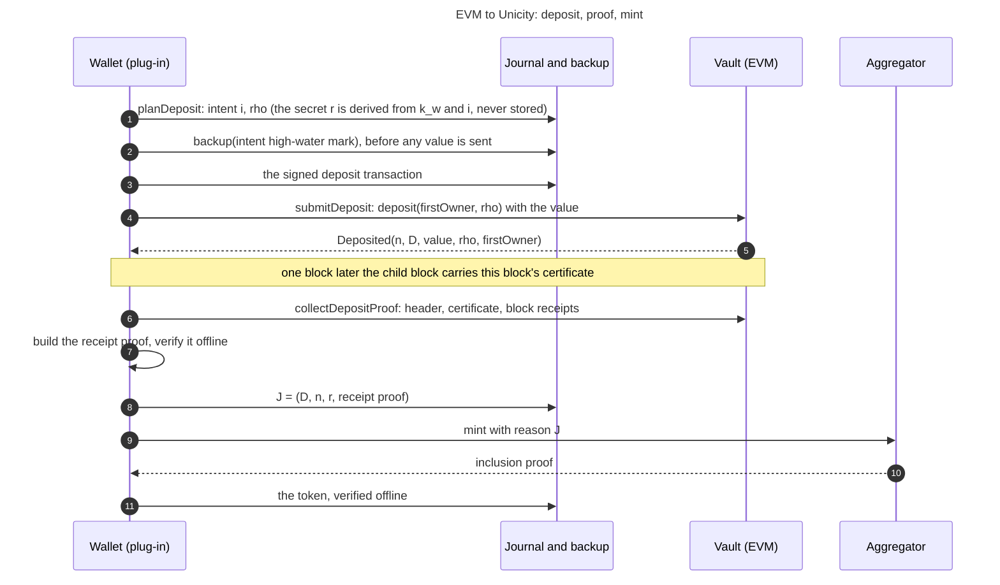

# Native bridge v2: wallet integration guide

This guide is for a wallet developer. It shows how to move native UCT between the EVM chain and Unicity with the TypeScript plug-in
(`packages/native-bridge-plugin`, entry point `./nb2`). You don't handle segments, gap proofs or receipt tries yourself: the plug-in builds and
checks them. The guide walks through the reference command-line wallet in [`wallet/`](../wallet), which runs every step, and you can follow it
on a test deployment.

The rules behind each step are in bft-core
[`docs/design/native-bridge-v2.md`](https://github.com/ristik/bft-core/blob/integration/enshrined-evm/docs/design/native-bridge-v2.md) (the
spec; section numbers below refer to it), [`protocol/interop.md`](../protocol/interop.md) (the bytes) and [`nb2-journal.md`](nb2-journal.md)
(the journal format).

> **Fake value only.** Every deployment of this release is a test deployment. Mint admission is still open (bft-core#1039, see
> [Limits](#limits)), and an oversized claim has no recovery path yet. Don't move real value through it.

- [What a user can do](#what-a-user-can-do)
- [Try it: the reference wallet](#try-it-the-reference-wallet)
- [The two flows](#the-two-flows)
- [Using the plug-in](#using-the-plug-in)
- [What to persist, and when](#what-to-persist-and-when)
- [What can go wrong](#what-can-go-wrong)
- [What it costs](#what-it-costs)
- [Limits](#limits)
- [RPC requirements](#rpc-requirements)

## What a user can do

- **Deposit.** Lock UCT in the vault contract on the EVM chain. The user gets the same amount as an ordinary Unicity token.
- **Spend it on Unicity.** Transfer and split the token like any other token. Nothing touches the EVM.
- **Return.** Burn a whole token part. The vault pays that part's amount to the EVM address the burn names.

A part is returned whole. To return 40 of a 100 token, split it into 40 and 60 first, then return the 40.

## Try it: the reference wallet

The reference wallet is a small command-line program on the plug-in, with one command per bridge step. Its core
([`wallet/core.ts`](../wallet/core.ts)) is also what the bft-core testnet lane drives, so the commands below are the ones the lane tests on
every run.

### What you need

- **The deployment's public files**, from its operator:
  - `nb2-release.json`, the release manifest. It holds the pins the wallet checks the deployment against (Γ, the vault's runtime code hash, the
    limits, the deployment block), the operating envelope, and the plug-in commit it was released with (`bridge.sources`).
  - `trust-base.bundle.cbor` and `trust-base.genesis.entryid`: the network's trust-base history and its pin.
- **The deployment's public gateway URL.** It is the ordinary JSON-RPC endpoint; the aggregator is its `/aggregator` route.
- **A checkout of this repository** at the commit the manifest names, with Node 22:

  ```sh
  git clone https://github.com/ristik/native-bridge-plugins && cd native-bridge-plugins
  git checkout <bridge.sources["native-bridge-plugins"] of nb2-release.json>
  npm ci
  ```

- **Some UCT on the EVM chain** for the deposit itself and for gas (the faucet of a test deployment).

Every command is `npx tsx wallet/nb2-wallet.ts [--wallet DIR] COMMAND ...`, written `nb2-wallet` below. The wallet directory defaults to
`./nb2-wallet`. It holds an **unencrypted** secret: this is a test wallet.

### A deposit and a split return

The transcript below is the `walkthrough` stage of the bft-core testnet lane (`deploy/testnet/bridge/nb2/rehearse_nb2.py`), from a run on a
four-validator package generation on the dev server, 2026-11-17 (the K = 4 test vault, see [Limits](#limits)). The lane runs the wallet inside
the package's own network, so the gateway is `http://rpc:8545`, and takes the key from its environment (`--key-env`). Without `--key-env`,
`init` makes a new secret in the wallet directory. On a public deployment, pass its public gateway URL.

TRANSCRIPT

What each step did:

1. **`init`** read the manifest and ran the installation check: the RPC serves the manifest's chain, the vault's `config()` is exactly the
   pinned Γ, and the vault's runtime code hash is the pinned one. It printed the EVM address to fund.
2. **`deposit coin 0.1`** derived the deposit secret from the wallet key and a fresh intent number, journaled it, handed the intent
   high-water mark to the backup, and only then sent `deposit` to the vault. The vault numbered the deposit (`Deposited` event).
3. **`mint coin`** waited for the deposit block's certificate (it is served once the next block exists), built the receipt proof `J`, checked
   it offline, and minted an ordinary Unicity token with `J` as its reason.
4. **`split`** made two whole parts, 0.06 and 0.04. This is the ordinary token split; the vault is not involved.
5. **`plan-return back`** ran the capacity preflight and burned nothing. It verified the part's whole provenance, chose the burn index from
   the newest verified `SegmentSealed` receipt (`a = 0` here: no segment sealed yet), and checked that the complete future redemption fits
   the transaction-size limit and `userGasLimit` with 64 segments of reserve, and that the paying address can fund the worst-case gas.
6. **`burn back`** ran the preflight again on fresh chain state, then certified the burn. The burn signs the recipient, the amount and the
   index, and its redemption ID `eta` is fixed from here on.
7. **`redeem back`** read one `SegmentSealed` log per segment since the index, built the gap proofs, sent the redeem transaction and waited
   for its block's certificate. Here the deployed verifier first answered `QuorumNotMet`: the EVM chain's seal registry had not imported the
   burn's root round yet (bft-core#1125). The wallet waited and built it again, and the vault paid. The second `redeem` found the payment and
   sent nothing.
8. **`status`** says where every deposit and return stands, and which command moves it on (`next: ...`). After a crash or a timeout, run that
   command again: every step resumes from the journal and never repeats an irreversible action.

The other commands are `address` (the EVM address, its balance and the wallet's Unicity owner key), `transfer NAME NEW [--to-key KEY]` (an
ordinary Unicity transfer, to another of the wallet's keys or to another wallet's key) and `tokens`. `plan-return` and `burn` take
`--recipient ADDR` to pay an address other than the wallet's own.

## The two flows



```mermaid
sequenceDiagram
    autonumber
    title Unicity to EVM: plan, burn, redeem
    participant W as Wallet (plug-in)
    participant J as Journal
    participant V as Vault (EVM)
    participant A as Aggregator
    W->>V: planReturn: the newest SegmentSealed receipt, state()
    W->>W: verify the part and the receipt offline; a = j + 1; capacity preflight
    W->>J: the plan (nothing irreversible yet)
    W->>V: burn: the preflight again, on fresh state
    W->>J: the exact burn request
    W->>A: certify the burn (R = D, asset, recipient, amount, a)
    A-->>W: inclusion proof
    W->>J: the certified burn and eta
    W->>V: buildRedeem: one SegmentSealed log per segment a .. c-1
    W->>W: check every log, build the gap proofs
    W->>J: the signed redeem transaction
    W->>V: submitRedeem: redeem(evidence, eta, a, history)
    V-->>W: Paid(eta, recipient, amount), the value to the recipient
```

## Using the plug-in

```ts
import { NativeBridgeV2, deriveBridgeKey, HttpJsonRpc, SdkAggregator, LocalKeySigner, localOwner } from '@unicitylabs/native-bridge-plugin/nb2';

const bridge = await NativeBridgeV2.open({
  pins,                                  // the manifest's pins (nb2-release.json "pins"; wallet/core.ts pinsOf reads them)
  trust,                                 // the network's trust-base history (TrustInput.fromBundle(bundle, pin))
  rpc: new HttpJsonRpc(gatewayUrl),      // the deployment's public gateway: nothing bridge-specific
  aggregator: new SdkAggregator(`${gatewayUrl}/aggregator`),
  journal: store,                        // your key-value store; its putIf MUST be atomic and durable (nb2-journal.md)
  bridgeKey: deriveBridgeKey(seed),      // k_w, from the wallet seed
  backup: async (intents) => { /* store the intent high-water mark with the seed backup */ },
  refreshTrust: async () => { /* append newer trust-base entries (wallet/trust.ts refreshAll) */ },
  // gas: optional; the default is the measured MeasuredGasModel, replaceable by any GasModel
});
```

`open` runs the installation check (the chain ID, `config()` against the pinned Γ, the runtime code hash) unless its second argument is
`false`. The two flows in code:

```ts
const plan = await bridge.planDeposit(100n, ownerKey);            // no network; journals the intent and calls backup
await bridge.submitDeposit(plan, evmSigner);                       // EVM; reconciles an earlier send instead of sending twice
await bridge.collectDepositProof(plan.intent);                     // EVM RPC; CompanionUnknown until the next block exists: retry
const token = await bridge.mint(plan.intent);                      // aggregator

const parts = await bridge.split(token, owner, [{ ownerKey, amount: 60n }, { ownerKey, amount: 40n }]);

const r = await bridge.planReturn(parts[1], evmRecipient, evmSigner.address);  // refuses before anything is burned
await bridge.burn(r.returnId, owner);                              // repeats the preflight, then certifies the burn
await bridge.submitRedeem(r.returnId, evmSigner);                  // builds the witness, sends, reconciles
```

`wallet/core.ts` wraps exactly these calls, one function per CLI command, with a file journal and a token store. Every call can be repeated
with the same identifier after a crash, and resumes where it stopped. `bridge.status()` describes every journaled deposit and return in words.

## What to persist, and when

| What | When | Why |
|---|---|---|
| The intent counter, and a **backup** of its high-water mark with the seed | before any deposit is sent | the deposit secret `r` derives from the seed and the intent number. Without the mark, a restored wallet can't find its deposits, and a lost secret is a lost deposit: there is no refund. `submitDeposit` refuses (`JournalNotPersisted`) until the backup has been taken. |
| Each deposit's record, then every signed deposit transaction | before broadcast | a retry reconciles the earlier send instead of depositing twice |
| `J`, the deposit evidence | as soon as the block is certified | minting later never depends on a provider |
| The token | after the offline check | it is the asset |
| The return plan | before the burn | it fixes the index `a` and the recipient |
| The burn request, then the certified burn | before certification, and before you report success | the burn is irreversible. Its index and recipient never change; only the witness is rebuilt. |
| Every signed redeem transaction | before broadcast | an ambiguous broadcast is resolved by that transaction's receipt |

The plug-in writes all of these through `JournalStore.putIf`, a compare-and-swap. It must be atomic and durable: it resolves only once the
value survives a crash, and no other write can land between its comparison and its write. Run one writer per journal.

What can be rebuilt: segment logs, gap trees, gap proofs, held witnesses, fee estimates and the trust-base history (refetched from the gateway
and checked from the pinned genesis entry). A wallet that deletes them and keeps the journal and its tokens still redeems; the lane's `cold`
stage does exactly that.

The reference wallet keeps all of this in its directory: `journal.json`, `backup.json` (the high-water mark; a real wallet stores it with
the seed backup, off the device), `tokens.json` with `tokens/*.cbor`, and `trust-history.cbor`.

## What can go wrong

Refusals carry a rule name (`Nb2Error.rule`, spec section 14) or a wallet reason (`WalletError.reason`). The vault's errors come back
from a simulation or a reverted transaction; `classifyRedeemError` maps them to the actions below, and `submitRedeem` applies them itself.

| Error | Where | Meaning | What the wallet does |
|---|---|---|---|
| `JournalNotPersisted` | submitDeposit | the plan or its backup is not durable | write and back up, then retry; nothing was sent |
| `JournalConflict` | any journaled step | another process advanced the same record | reload; the record that won is the truth. Run one writer per journal. |
| `CompanionUnknown` | collectDepositProof, planReturn | the block's certificate is not served yet (no child block), or the node is on another chain | retry after a block |
| `EvidencePruned` | any evidence read | this node no longer serves the companion, block or receipts | use another provider or an archive |
| `ProviderFault` | any evidence read | the provider served data that contradicts itself (a wrong hash or root), or an answer over the gateway's 8 MiB cap (HTTP 413) | use another provider; for a 413 on logs the plug-in narrows the window itself |
| `EvidenceMissing` | buildRedeem | a segment log was not served | use another provider. A missing log is never read as "not paid". |
| `SegmentLog` | buildRedeem | a served log has the wrong length, order or chain link | use another provider |
| `NoEntryForEpoch` (also inside `SealReceipt`) | verification | a certificate's epoch is newer than the held trust history | extend the history (`refreshTrust`) and retry; the evidence is not invalid |
| `SealReceipt` (other inner rules) | planReturn | the newest seal receipt does not verify | use another provider; nothing is burned |
| `CapacityPreflight` | planReturn, burn | the return would not fit the transaction-size limit or `userGasLimit`, with the history already owed plus the reserve, or its gas can't be bounded | **don't burn**. The token stays spendable on Unicity. See [Limits](#limits). |
| `InsufficientFunds` | planReturn, burn | the paying EVM address can't fund the worst-case gas limit | fund it; nothing is burned |
| `RecipientRefused` | planReturn | the zero address or the vault | choose another recipient |
| `StateReadNotAdmitted` / `ImplausibleIndex` | planReturn with `useStateRead` | a plain `state()` read is evidence only on a deployment whose manifest says `stateReadOnly`, and only within `maxJump` | use the seal receipt (the default) |
| `Unconfirmed` | submitDeposit, the aggregator | a send has no receipt yet, or its nonce was used by a transaction seen too recently to call the send dead; or no inclusion proof yet | call again later; it reconciles, and signs a new transaction only after the old one is dead at depth |
| `CapacityExceeded` | buildRedeem | the claim grew past the limits after the burn | no recovery in this release (continuation, bft-core#1108, is deferred); tell the user |
| `AlreadyPaid` (vault) | simulation | the identifier is in a recent buffer | reconcile: look for `Paid(eta)` (automatic) |
| `StaleEndpoint` (vault) | simulation | two seals since the witness was built | rebuild the witness (automatic); never a new burn |
| `FutureIndex` (vault) | simulation | the vault has not reached `a` | wait; can't arise from a verified seal receipt |
| `BadGapProof`, `ChainMismatch`, `BadHistoryLength` (vault) | simulation | a wrong proof or start head | rebuild the witness; the burn stays |
| `PayoutFailed`, `Reentrancy` (vault) | transaction | the recipient refused the value, or re-entered | retry once; a recipient that always refuses strands the burn |
| `VerifierRefused(QuorumNotMet)` (vault) | simulation, right after a burn | usually the EVM chain's seal registry has not imported the burn's root round yet (bft-core#1125); on chain that reads as a bad quorum | wait a few blocks and build again; the reference wallet waits up to 2 minutes, then reports it |
| `VerifierRefused(<other rule>)` (vault) | simulation | the token verifier refused the evidence with `<rule>` | stop and report. Retry only if the inner rule is `NoEntryForEpoch`. |
| `DomainMismatch`, `AssetMismatch`, `ClaimMismatch`, `BadRecipient`, `ZeroAmount`, `LiabilityUnderflow`, `SegmentCounterExhausted` (vault) | simulation | the evidence is not for this vault, or the vault is exhausted | stop and report |
| `ZeroValue`, `BadFirstOwner`, `LiabilityCap`, `DepositCounterExhausted` (vault) | deposit | the deposit itself is refused | fix the amount or owner; nothing was locked |
| `UnlockRecovery` | verification | an unlock in the lineage uses recovery ID 2 or 3 | the token is still valid on Unicity but can't be returned; refuse to accept it for a return |
| HTTP 429, or 503 "busy" | any gateway call | rate limit, or both large-body slots in use | back off and retry (the plug-in's `HttpJsonRpc` does) |
| HTTP 400, connection closed | `eth_sendRawTransaction`, `eth_call`, `eth_estimateGas` | the body is over the gateway's large-body bound; it is refused on its declared length, unread | a transaction within `maxEncodedTxBytes` never hits this; the preflight keeps a return within it |
| HTTP 503 "broadcast may be partial" | `eth_sendRawTransaction` | ambiguous: the transaction may still be included | poll the receipt of the locally computed hash and look for `Paid(eta)` before resending (automatic) |

## What it costs

Gas prices are the deployment's; on the package's test network a gas unit cost 10^6 wei. The figures are gas units.

**Measured live** (NB2-09 lane run, bft-core CI run 44037100193, and the walkthrough above; the K = 4 test vault):

| Operation | Gas used |
|---|---:|
| Deposit (the walkthrough's `deposit`) | 31,751 |
| Return of an origin-only token (no transfer) | 882,230 |
| Return after one transfer | 1,056,450 |
| Return of a part one split level down (the walkthrough's `back`) | 1,385,445 |
| Return after one transfer and one split (`p60`) | 1,582,088 |
| Return of a part three split levels down | 2,411,141 |
| Return after 13 transfers, one certificate each | 3,554,807 |
| Return after 40 transfers in 4 certificates | 7,179,054 |
| Return after 204 transfers (the largest the preflight admitted in that run) | 36,951,383 |

**What the user has to hold.** The redeem transaction's gas limit is the estimate plus `gasReserve` = 500,000 (spec section 12.4): other
users' payments can make any return the sealing one (the K-th payment of a segment seals it, up to about 230,000 gas more) or the worst scan
of the recent buffers (up to about 283,000 more). The reserve is limit, not spend: only the return that seals pays the sealing gas. The preflight before the burn uses
a larger, conservative bound: the burn is counted at the decoder's bounds (about 4.5M gas) and 64 segments of future history are added. The
walkthrough's 0.04 part was planned at 7,533,927 gas, sent with a limit of 1,897,608, and used 1,385,445. The paying address must be able to
fund the preflight's limit at twice the base fee plus the tip, or the preflight refuses with `InsufficientFunds` and nothing is burned.

**How cost grows with the token's history.** The token verifier's gas grows with every transfer and split level in the part's lineage. The
plug-in's measured model (`MeasuredGasModel`, from unicity-pos-contracts#82 `docs/nb2-verifier.md`) rounds each term up: 800,000 base,
190,000 per transfer, 760,000 per split level, plus bytes and signatures beyond the measured shape. A transfer certified alone costs more
than one certified in a batch with others, because each distinct certificate is verified. On the 204-transfer probes the live cost was about
240,000 gas per transfer.

**How cost grows with waiting.** A burn's redemption proves that `eta` was not paid in any segment sealed since its index: one gap proof
per segment, `65 + 32 log2 K` bytes, about 5,950 gas each at K = 64 (257 bytes; 129 bytes at the test vault's K = 4). A segment seals every K
payments to the vault, so at K = 64 and one payment a second the history grows by about one proof a minute. The NB2-02 bake-off
(unicity-pos-contracts#80 `bench/nb2/RESULTS.md`, K = 64, the vault alone, without the token verifier) measured a return with 1 / 10 / 100
segments of history at 72,852 / 126,393 / 661,926 gas, and the sealing return (the 64th payment of a segment) at up to 342,766.

## Limits

**The operating envelope.** The manifest pins the limits a wallet plans against (`pins`, with their sources under `limits`). On the package
deployment:

| Limit | Value |
|---|---|
| `maxEncodedTxBytes` (L_max), the largest redeem transaction a wallet may build | 512 KiB (524,288 bytes) |
| `userGasLimit`, the gas of one transaction | 60,000,000 |
| `gasReserve`, added to every redeem's gas limit | 500,000 |
| `returnReserveSegments`, the future history the preflight provisions for | 64 segments (4,096 payments at K = 64) |

Gas binds long before bytes: the largest return that fits `userGasLimit` carries about 300 KB of evidence. The manifest's `envelope` gives the
model's estimate (about 280 transfers for an unsplit token, about 4 fewer per split level) and, for a reference part, how long a burn may
wait before its history no longer fits. In the NB2-09 run the preflight admitted 204 batch-certified transfers and refused 206, and both
verdicts were confirmed against the chain: the admitted token was burned and paid within `userGasLimit`, and each refused token's state was
shown unspent by a verified non-inclusion proof from the aggregator after the refusal.

**The boundary drifts, so plan right before you burn.** A return's gas depends on the token's own history and on the aggregator's tree,
which keeps growing: in one live session, fresh probes of the same length carried about 991 more evidence bytes each, and the boundary moved
by about 2 transfers within that session. So:

- run `planReturn` right before `burn` (the reference wallet's `burn` does, and the plug-in repeats the preflight once more before it signs);
- never reuse a limit measured earlier, by you or by anyone else;
- treat the envelope as guidance, not admission.

**The preflight is the safety gate.** It refuses before the burn: a refused return never burns, and the token stays spendable on Unicity.
The lane asserts this on every boundary probe against the chain.

**A history over the limit can't be returned in this release.** Splitting does not help: a part carries its parent's whole history, and
each split level adds about four transfers' worth of gas. Keep tokens meant for return well inside the envelope, and return them before
their history gets near it. A claim that outgrows the limits after its burn (`CapacityExceeded`) has no recovery yet; continuation is
deferred to bft-core#1108. The preflight exists to stop such a burn before it happens.

**Freshness of the index.** The burn index comes from the newest seal receipt the provider serves, and the endpoint estimate from its
`state()` view. A provider that hides newer seals can't push the index into the future; it can only anchor it lower, which means more history
to prove. `planReturn` warns when the newest receipt is older than `maxSealAgeBlocks` (7,200 by default). Neither check guarantees redemption
against an indefinitely stale view or arbitrary later traffic.

**The recipient.** The burn signs one EVM address, and only that address is paid. Use an address you control that accepts plain value
transfers. A contract recipient gets a warning: if it ever refuses the payment, the burn is stuck.

**A reused deposit secret** (two devices restored from one backup, or a faulty wallet) gives two deposits with one `rho`. Each is its own
root token: `recoverDeposits` journals both, and `mintExtraDeposit` mints the second.

**Unlock recovery IDs.** Every unlock in a returnable token's lineage must use recovery ID 0 or 1. The plug-in's own signatures always do.

**Mint admission is still open (bft-core#1039).** A token's first state is registered with the aggregator under an ID that anyone who knows
the token ID can sign for (the SDK's mint key is public by design), and the aggregator keeps the first registration of an ID for good. In
this bridge the token ID depends on the deposit secret, so watching the EVM chain is not enough to work it out in advance. But once the mint
request is visible, on its way to the aggregator or to a dishonest aggregator, someone can register a competing first state for the same ID
ahead of it. The honest mint can then never be certified, and the deposit is stranded: the vault has no refund. Until that issue is fixed,
the bridge is a test system. Don't move real value through it.

## RPC requirements

Any node that meets the wallet RPC contract (spec section 12.7, NB2-06, bft-core#1102) works. There is no bridge-specific service, and
nothing read is trusted: every item is verified offline, so a provider that withholds data can only delay the wallet.

| Need | Method |
|---|---|
| The certificate of block N | `eth_getBlockByNumber(N+1, false)`, then `unicity_getSealCompanionV1(hash(N+1))`: `{"status":"found"}`, witness 0 |
| The header of block N | `eth_getBlockByHash(hash, false)` |
| The receipt-trie path | `eth_getTransactionReceipt`, `eth_getBlockReceipts(hash)` |
| Segment logs, the newest seal, `Paid(eta)` | `eth_getLogs` with exactly one address and explicit windows of at most 10,000 blocks |
| Vault views | `eth_call` of `config()`, `state()`, `domain()` |
| Simulation and submission | `eth_call`, `eth_estimateGas`, `eth_sendRawTransaction` |
| Retention | `unicity_sealCompanionHorizonV1` answers `null`: nothing is pruned |
| Trust-base history | `GET /api/v1/trustbases` on the same host (the SDK's trust-base path) |

What the package's public gateway enforces, and what the plug-in does about it:

- Bodies are at most 16 KiB, except `eth_call`, `eth_estimateGas` and `eth_sendRawTransaction`, which take up to 4.5 MiB (room for a
  512 KiB transaction hex-encoded). A body declared larger is refused with HTTP 400 and the connection is closed, unread. At most two large
  bodies are read at once (503 "busy": retry).
- Rate limits answer HTTP 429; the plug-in backs off.
- One answer is at most 8 MiB (HTTP 413 above it). The plug-in halves a log window on a 413 or on the node's result-count error.
- `eth_sendRawTransaction` is relayed to every validator. Its HTTP 503 ("broadcast may be partial") is ambiguous: the plug-in polls the
  receipt of the hash it computed itself, and checks `Paid(eta)`, before it sends anything again.
- Retention: the nodes behind the gateway are proof sources, so companions, receipts and logs are served for the life of the deployment.
  Deposit evidence can be fetched at any time after the deposit's child block exists, and segment logs from the deployment block on. The
  wallet still builds `J` right away and keeps it with the token, so minting never depends on a provider.

Another node meets the contract if it serves these methods with the same answers: an execution client of the deployment's chain that
serves the `unicity_` methods (ureth) and runs as a proof source, its default.
