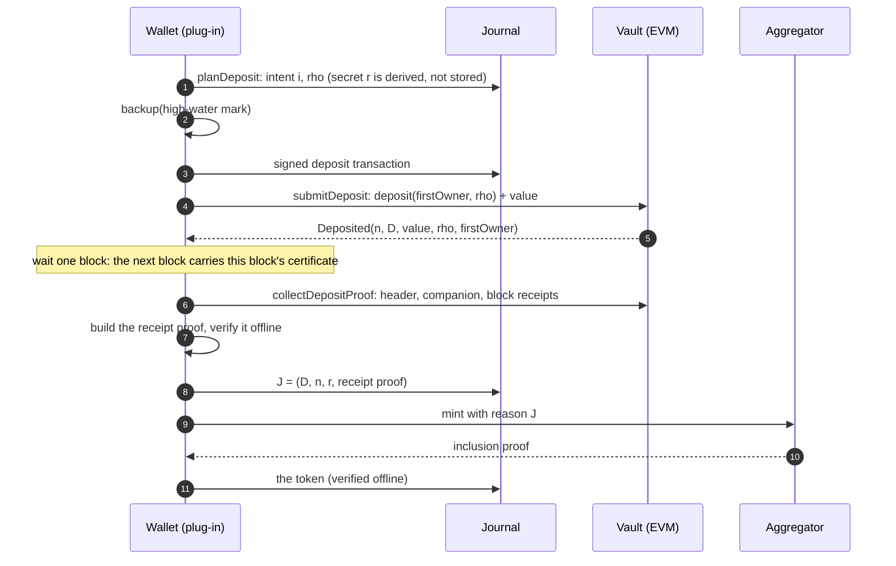

# Native bridge v2: wallet integration guide (draft)

**Draft for NB2-11 (bft-core#1107).** This draft covers the TypeScript plug-in's API (NB2-07, bft-core#1103). The reference
command-line wallet, the command transcript and the live numbers come **after NB2-09** (bft-core#1105), and are marked that way
below. The normative rules are in bft-core `docs/design/native-bridge-v2.md` (the spec) and `protocol/interop.md`.

This guide is for a wallet developer. You can bridge native UCT between the EVM chain and Unicity without handling segments, gap
proofs or receipt tries yourself.

## What a user can do

- **Deposit.** Lock UCT in the vault contract on the EVM chain. The user receives the same amount as an ordinary Unicity token.
- **Spend it on Unicity.** Transfer and split the token like any other token. Nothing touches the EVM.
- **Return.** Burn a whole token part. The vault pays that part's amount to an EVM address the burn names.

A part is returned whole. To return 40 of a 100 token, split it into 40 and 60 first, then return the 40.

## Setup

```ts
import { NativeBridgeV2, deriveBridgeKey, HttpJsonRpc, SdkAggregator, LocalKeySigner, localOwner } from '@unicitylabs/native-bridge-plugin/nb2';

const bridge = await NativeBridgeV2.open({
  pins,                                  // the deployment manifest: Γ, limits, code hash, deployment block (written by NB2-09)
  trust,                                 // the network's trust-base history (TrustInput.fromBundle)
  rpc: new HttpJsonRpc(gatewayUrl),      // the deployment's public gateway, nothing bridge-specific
  aggregator: new SdkAggregator(aggregatorUrl),
  journal: store,                        // your durable key-value store (docs/nb2-journal.md)
  bridgeKey: deriveBridgeKey(seed),      // k_w
  backup: async (intents) => { /* back up the intent high-water mark with the seed */ },
  refreshTrust: async () => { /* append newer trust-base entries */ },
  gas,                                   // a measured GasModel; or allowProvisionalGas: true to accept the provisional one
});
```

`open` runs the installation check: the chain ID, the vault's `config()` against the pinned Γ, and the vault's runtime code hash.

## The two flows



```mermaid
sequenceDiagram
    autonumber
    participant W as Wallet (plug-in)
    participant J as Journal
    participant V as Vault (EVM)
    participant A as Aggregator
    W->>V: planReturn: the newest SegmentSealed receipt
    W->>W: verify the token and the receipt offline: a = j + 1; capacity preflight
    W->>J: the plan
    W->>J: burn: the exact burn request
    W->>A: certify the burn (R = D, asset, recipient, amount, a)
    A-->>W: inclusion proof
    W->>J: the certified burn, eta
    W->>V: buildRedeem: one SegmentSealed log per segment a .. c-1
    W->>W: check every log, build the gap proofs
    W->>J: signed redeem transaction
    W->>V: submitRedeem: redeem(evidence, eta, a, history)
    V-->>W: Paid(eta, recipient, amount); value to the recipient
```

In code:

```ts
const plan = await bridge.planDeposit(100n, ownerKey);           // no network
await bridge.submitDeposit(plan, evmSigner);                      // EVM
await bridge.collectDepositProof(plan.intent);                    // EVM RPC; retry CompanionUnknown after a block
const token = await bridge.mint(plan.intent);                     // aggregator

const parts = await bridge.split(token, owner, [{ ownerKey, amount: 60n }, { ownerKey, amount: 40n }]);

const r = await bridge.planReturn(parts[1], evmRecipient, evmSigner.address);  // refuses before anything is burned
await bridge.burn(r.returnId, owner);                             // aggregator
await bridge.submitRedeem(r.returnId, evmSigner);                 // builds the witness, sends, reconciles
```

Every call can be repeated with the same identifier after a crash, and resumes where it stopped.

## What to persist, and when

| What | When | Why |
|---|---|---|
| The intent counter, and a **backup** of its high-water mark with the seed | before any deposit is sent | the secret `r` derives from the seed and the intent number; without the mark, a restored wallet cannot find its deposits. A lost secret is a lost deposit: there is no refund. |
| Each deposit's record, then every signed deposit transaction | before broadcast | a retry reconciles the earlier send instead of depositing twice |
| `J` (the deposit evidence) | as soon as the block is certified | later minting never depends on a provider |
| The token | after the offline check | it is the asset |
| The burn request, then the certified burn | before certification, and before you report success | the burn is irreversible. Its index and recipient never change; only the witness is rebuilt. |
| Every signed redeem transaction | before broadcast | an ambiguous broadcast is resolved by that transaction's receipt |

The plug-in writes all of these through `JournalStore.put`, which must be durable. Segment logs, gap trees, proofs and fee estimates
are rebuilt on demand. A wallet that deletes them and keeps the journal still redeems.

`submitDeposit` refuses in these cases:

- the plan's record is missing;
- the record differs from the plan;
- the high-water mark does not cover the intent;
- the mark is not backed up (`JournalNotPersisted`).

## What can go wrong

Refusals carry a rule name (`Nb2Error.rule`, section 14 of the spec) or a wallet reason (`WalletError.reason`). The vault's errors
come back from a simulation or a reverted transaction. `classifyRedeemError` maps them to the actions below, and `submitRedeem`
applies them itself.

| Error | Where | Meaning | What the wallet does |
|---|---|---|---|
| `JournalNotPersisted` | submitDeposit | the plan or its backup is not durable | write and back up, then retry; nothing was sent |
| `JournalConflict` | any journaled step | another process advanced the same record | reload; the record that won is the truth. Run one writer per journal. |
| `CompanionUnknown` | collectDepositProof, planReturn | the block's certificate is not served yet (no child block), or the node is on another chain | retry after a block |
| `EvidencePruned` | any evidence read | this node no longer serves the companion, block or receipts | use another provider or an archive |
| `ProviderFault` | any evidence read | the provider served data that contradicts itself: a wrong hash or root, or an answer over the gateway cap (HTTP 413) | use another provider |
| `EvidenceMissing` | buildRedeem | a segment log was not served | use another provider. A missing log is never read as "not paid". |
| `SegmentLog` | buildRedeem | a served log has the wrong length, order or chain link | use another provider |
| `NoEntryForEpoch` (also inside `SealReceipt`) | verification | a certificate's epoch is newer than the held trust history | extend the history (`refreshTrust`) and retry; the evidence is not invalid |
| `SealReceipt` (other inner rules) | planReturn | the newest seal receipt does not verify | use another provider; nothing is burned |
| `CapacityPreflight` | planReturn | the return would not fit the transaction-size limit or `userGasLimit`, with the history already owed plus the reserve, or its gas cannot be bounded | **do not burn**. Choose a smaller lineage, or wait for a deployment with larger limits. |
| `InsufficientFunds` | planReturn | the paying EVM account cannot fund the worst-case gas limit | fund it; nothing is burned |
| `RecipientRefused` | planReturn | the zero address or the vault | choose another recipient |
| `StateReadNotAdmitted` / `ImplausibleIndex` | planReturn with `useStateRead` | a plain `state()` read is evidence only on a test deployment, and only within `maxJump` | use the seal receipt (the default) |
| `Unconfirmed` | submitDeposit | a send has no receipt yet, or its nonce was used by a transaction seen too recently to call the send dead | call again later; it reconciles, and signs a new transaction only after the old one is dead at depth |
| `CapacityExceeded` | buildRedeem | the claim grew past the limits after the burn | no recovery in this release (continuation, bft-core#1108, is deferred); tell the user |
| `AlreadyPaid` (vault) | simulation | the identifier is in a recent buffer | reconcile: look for `Paid(eta)` |
| `StaleEndpoint` (vault) | simulation | two seals since the witness was built | rebuild the witness (automatic); never a new burn |
| `FutureIndex` (vault) | simulation | the vault has not reached `a` | wait; cannot arise from a verified seal receipt |
| `BadGapProof`, `ChainMismatch`, `BadHistoryLength` (vault) | simulation | a wrong proof or start head | rebuild the witness; the burn stays |
| `PayoutFailed`, `Reentrancy` (vault) | transaction | the recipient refused the value, or re-entered | retry once; a recipient that always refuses strands the burn |
| `VerifierRefused(<rule>)` (vault) | simulation | the token verifier refused the evidence with `<rule>` | stop and report. Retry only if the inner rule is `NoEntryForEpoch`. |
| `DomainMismatch`, `AssetMismatch`, `ClaimMismatch`, `BadRecipient`, `ZeroAmount`, `LiabilityUnderflow`, `SegmentCounterExhausted` (vault) | simulation | the evidence is not for this vault, or the vault is exhausted | stop and report |
| `ZeroValue`, `BadFirstOwner`, `LiabilityCap`, `DepositCounterExhausted` (vault) | deposit | the deposit itself is refused | fix the amount or owner; nothing was locked |
| `UnlockRecovery` | verification | an unlock in the lineage uses recovery ID 2 or 3 | the token is still valid natively but cannot be returned; refuse to accept it for return |

## What it costs

These figures are measured by the NB2-02 bake-off (unicity-pos-contracts#80 `bench/nb2/RESULTS.md`, `K = 64`, `B = 16`, Cancun). Each
is one whole transaction with every slot cold, and includes base gas and calldata. The token verifier is excluded: NB2-05 measures it.

| Operation | Gas |
|---|---:|
| Deposit, first in a fresh vault | 48,758 |
| Deposit, steady state | 31,670 |
| Return, typical (current segment half full), no history | 63,791 |
| Return whose witness ends one segment back | 78,083 |
| Each sealed segment of waiting (one gap proof, 257 bytes of calldata) | 5,950 |
| Return with 1 / 10 / 100 segments of history | 72,852 / 126,393 / 661,926 |
| The sealing return (the 64th payment of a segment), uniform / worst bucket | 299,630 / 342,766 |

On top of these:

- **Reserve.** Every return's gas limit is the expected cost plus `gasReserve = 500,000`. Other users' payments can make any return the
  sealing one, or the worst scan. The reserve is limit, not spend, but the paying account must hold it (`InsufficientFunds`).
- **Token verification.** This grows with the token's history: every certificate of the lineage, the deposit receipt, and every split
  above the part. The plug-in's estimate is provisional and deliberately high until NB2-05's numbers replace it
  (`ProvisionalGasModel`; swap in a measured `GasModel`). Typical figures come **after NB2-09**.
- **Waiting.** A burn's history grows by one gap proof per 64 payments to the vault after the burn's index. At 1 payment per second, that
  is about 5,950 gas and 257 bytes per minute.

## Limits

- **Freshness of the index (an availability assumption).** The burn index comes from the newest seal receipt that the provider
  serves, and `c_obs` from its `state()` view. A provider that hides newer seals cannot push the index into the future; it can only
  anchor it lower, which means more history to prove. `planReturn` warns when the newest receipt is older than `maxSealAgeBlocks`
  (7,200 by default). `burn` repeats the preflight against a fresh state before it signs. Neither check guarantees redemption against
  an indefinitely stale view or arbitrary later traffic.
- **A reused deposit secret** (two devices restored from one backup, or a faulty wallet) yields two deposits with one `rho`. Each is
  its own root token: `recoverDeposits` journals both, and `mintExtraDeposit` mints the second.

- **Operating envelope.** The deployment manifest pins:
  - the encoded-transaction limit (`L_max`, 512 KiB by default);
  - `userGasLimit`;
  - `returnReserveSegments` (64 by default).

  Before burning, `planReturn` adds the history already owed since the index to the reserve, and requires the whole prospective return
  to fit both limits. The published envelope (the largest token, and the return delay at stated traffic) comes **after NB2-09**.
- **Oversized claims.** A claim that outgrows the limits after its burn cannot be redeemed in this release. There is no recovery path
  yet: continuation is deferred to bft-core#1108. The preflight exists to stop such a burn before it happens.
- **Recipient.** The burn signs one EVM address, and only it is paid. Use an address you control that accepts plain value transfers. A
  contract recipient produces a warning: if it ever refuses the payment, the burn is stuck.
- **Mint admission (#1039).** A chain observer cannot compute a deposit's token ID, so it cannot block the mint in advance. But anyone
  who sees the mint request, or a hostile aggregator, can still race it. Until that issue is fixed, the network treats a working mint
  admission as a prerequisite for real value. Do not move real value through this release.
- **Unlock recovery IDs.** Every unlock in a returnable token's lineage uses recovery ID 0 or 1. The plug-in's own signatures always do.

## RPC requirements

Any node that meets the wallet RPC contract (spec section 12.7) works. No bridge-specific service exists.

| Need | Method |
|---|---|
| The certificate of block N | `eth_getBlockByNumber(N+1, false)`, then `unicity_getSealCompanionV1(hash(N+1))`, witness 0 |
| The header of block N | `eth_getBlockByHash(hash, false)` |
| The receipt-trie path | `eth_getTransactionReceipt`, `eth_getBlockReceipts(hash)` |
| Segment logs, the newest seal, `Paid(eta)` | `eth_getLogs` with one address and windows of at most 10,000 blocks |
| Vault views | `eth_call` of `config()`, `state()` |
| Submission | `eth_estimateGas`, `eth_sendRawTransaction` |

Gateway behaviour the plug-in handles:

- it backs off on HTTP 429 and on a busy 503;
- it halves a log window on a result-count error or on HTTP 413 (the 8 MiB answer cap);
- it treats HTTP 503 from `eth_sendRawTransaction` as ambiguous (the transaction may still land): it polls the receipt of the
  transaction hash it computed itself, and checks `Paid(eta)`, before it resends anything.

Retention: nodes behind the public gateway serve companions, receipts and logs for the life of the deployment.

## Reference wallet

The command-line wallet (`deploy/testnet/bridge/tester`, rewritten on this API, with one command per step and a `status` command)
comes **after NB2-09**, together with the transcript of a testnet deposit and split return. `bridge.status()` already gives the
wording that `status` will print for each journaled deposit and return.
